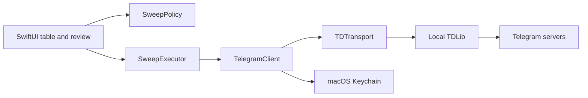

# Architecture

## Boundaries

`ChatSlaughter` contains SwiftUI views and the AppKit termination delegate.
`ChatSlaughterCore` contains models, policy, execution, authorization,
Keychain access and the TDLib transport. There are no external Swift packages.
TDLib is dynamically loaded from the app bundle or a developer path.

All published application state and request continuations belong to MainActor.
One utility dispatch queue receives JSON events from TDLib. Each received C string
is copied before the next call. A UUID in `@extra` identifies each pending request;
continuations have deadlines. Events reach MainActor in receive order.

TDLib is not unloaded while its functions can be in use. Application termination
waits for the current batch item and `authorizationStateClosed` before exiting.
A wedged TDLib shutdown can delay quitting; there is no unsafe forced teardown.

## Data and authorization

Keychain stores API credentials and the encryption key. The TDLib directory is
outside the repository, under Application Support. Logging is disabled before
creating the TDLib client. No account data or API keys are compiled into the app.
The initial `updateOption(version)` selects the parameter schema: requesting
`getOption` before initialization can hang with TDLib 1.8.0, so it is not used.

Supported authorization states: parameters, legacy database key, phone, login code,
2FA password, email, email code, ready and closed. Unsupported states receive an
explicit message. A signed-out session requires restarting the app to reconnect.
A single account and a single transport are supported per process.

Chat loading iterates `loadChats` in pages for main and archive until the documented
404 end condition. Incoming positions determine visible membership; cache size is
not treated as the chat-list size. Updates for users, positions, titles, last
messages, drafts and unread counts refresh the table. Reading a list does not
mark chats as read or download their histories.

## Destructive operations

1. Selection is restricted to visible results and excludes protected chat types.
2. Review fetches each selected chat and own membership via `getChatMember`.
3. A fixed plan is presented, including rejected items and reasons.
4. Immediately before each item, the policy is checked again.
5. The executor sends only `leaveChat` or `deleteChatHistory(revoke=false)`.
6. After leaving, self-delete capability is fetched separately. Failure here is
   a partial result, not a report that the leave operation failed.

Owned groups/channels, Saved Messages, secret chats, unknown membership and
unavailable private self-delete capability are blocked. The application never
calls `deleteChat`, which could destroy a group for all members.

The queue is serial, with a 700 ms inter-item delay. Explicit 429 rate limits are
retried at most twice, each wait capped at 300 seconds and interruptible between
seconds. Mutations that time out are never replayed; the rest of the batch stops.
There is no crash recovery or persisted batch journal, so restart cannot silently
resume a destructive batch. Stop finishes the current chat, including cleanup
after a successful leave, and skips the remainder.

## Verification and remaining release work

The Swift Testing suite covers policy restrictions, mutation payload semantics,
serial execution, stop behavior, flood waits, changed chat types, partial results
and timeout handling. An opt-in integration test starts the installed TDLib,
receives initial events, matches a request response and closes without login.

Before a stable release: live test-account authorization and mutations; validation
with current upstream TDLib; Apple Silicon and Intel builds; VoiceOver and
keyboard QA; English localization; Developer ID signing and notarization. Current
membership checks can race a remote role change: Telegram remains authoritative
for request permissions, and the app reports the returned error.

Official API references:

- https://core.telegram.org/tdlib/getting-started
- https://core.telegram.org/tdlib/docs/td__json__client_8h.html
- https://core.telegram.org/tdlib/docs/classtd_1_1td__api_1_1delete_chat_history.html
- https://core.telegram.org/api/obtaining_api_id
- https://core.telegram.org/api/terms
